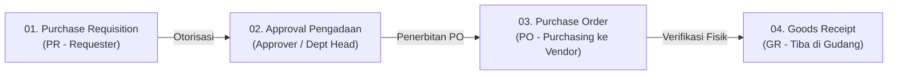
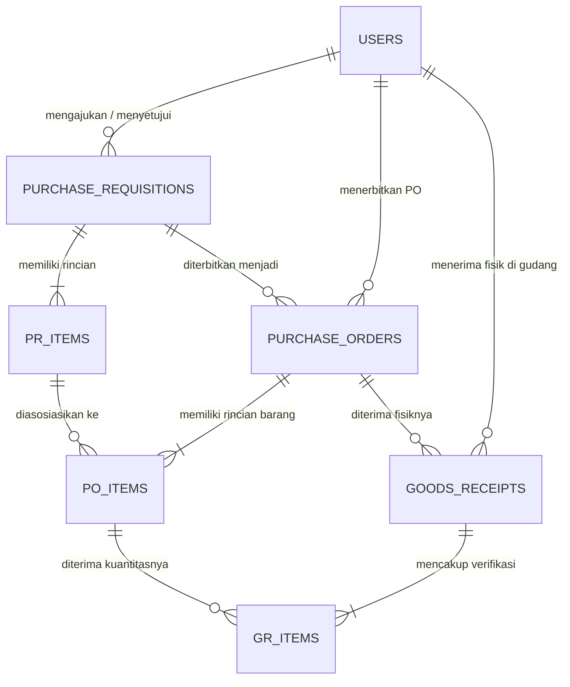

# PROCURE-APP &bull; Enterprise Procurement Management Portal

<p align="center">
  
</p>

<p align="center">
  <strong>Sistem Terpadu Manajemen Pengadaan Barang &amp; Jasa Berbasis Web</strong><br>
  Dibangun dengan arsitektur modern menggunakan <strong>Python (Flask)</strong>, <strong>SQLAlchemy ORM</strong>, database relasional <strong>SQLite (ACID Compliant)</strong>, serta antarmuka elegan dan responsif berbasis <strong>Bootstrap 5 &amp; Vanilla CSS</strong>.
</p>

<p align="center">
  
  
  
  
  
  
</p>

---

## 1. Ruang Lingkup Sistem (Scope of Work)

Aplikasi **PROCURE-APP** mencakup alur lengkap siklus pengadaan barang (*End-to-End Procurement Lifecycle*) dari awal identifikasi kebutuhan hingga fisik barang diterima dan diverifikasi di gudang:



1. **Tahap 1: Purchase Requisition (PR) &bull; Pemohon (Requester)**
   - Pengajuan daftar kebutuhan barang/jasa dengan form multi-item dinamis (tambah/hapus baris tanpa reload).
   - Perhitungan estimasi biaya, subtotal, dan total anggaran secara *real-time*.
   - Penetapan tanggal kebutuhan (*required date*) dan tujuan permohonan.
2. **Tahap 2: Approval Review &bull; Pimpinan Divisi (Approver)**
   - Peninjauan dokumen PR yang diajukan departemen secara objektif.
   - Hak otorisasi penuh: **Setujui (Approve)** atau **Tolak (Reject)** dengan catatan evaluasi formal.
3. **Tahap 3: Purchase Order (PO) &bull; Bagian Pengadaan (Purchasing)**
   - Penerbitan surat pesanan resmi kepada vendor rekanan terpilih untuk PR yang telah disetujui.
   - Pengaturan ketentuan pembayaran (*Payment Terms* seperti *Net 30*, *COD*, *DP 50%*), estimasi pengiriman vendor, dan negosiasi harga deal satuan.
4. **Tahap 4: Goods Receipt (GR) &bull; Bagian Gudang & Logistik (Warehouse)**
   - Verifikasi fisik barang yang tiba di gudang dan mencocokkannya dengan Surat Jalan vendor (*Delivery Order* / DO) dan Purchase Order.
   - Pemeriksaan kuantitas & kelayakan fisik barang (*Baik/Sesuai*, *Rusak*, *Tidak Sesuai Tipe*).
   - Pemutakhiran otomatis status PO menjadi **Received (Lengkap)** atau **Partially Received (Sebagian)**.

> **Batasan Sistem (Out of Scope):**  
> Sesuai spesifikasi teknis Soal: Sistem ini **tidak mencakup** aplikasi gudang lanjutan (kartu stok internal, mutasi rak gudang, bin/rack slotting) maupun modul pembayaran/keuangan (*Accounts Payable* / pembayaran invoice faktur pajak). Fokus utama adalah siklus pengadaan dari awal **Request (PR)** hingga **Barang Sampai di Gudang (GR)**.

---

## 2. Kepatuhan Spesifikasi Soal Ujian (Take Home Test)

Repositori ini ditujukan khusus untuk pemenuhan **Soal 2 — Programming (Web App Python + SQLite)** sesuai ketentuan lembar soal Cineul Technologies:
- **Soal 1a (Swimlane BPMN):** Dibuat menggunakan draw.io dan dikonversi menjadi dokumen PDF resmi terpisah.
- **Soal 1b (Work Breakdown Structure):** Disusun dalam berkas spreadsheet Excel (.xlsx) resmi terpisah.
- **Soal 2 (Web Application):** Repositori GitHub mandiri tunggal (*Single Repository*) berisi seluruh source code aplikasi pengadaan berbasis Python Flask, SQLite relasional, antarmuka Bootstrap 5 responsif, dan dukungan AI Vision Suite.

---

## 3. Fitur Opsional Nilai Plus: Computer Vision & AI Vision Suite

Menjawab ketentuan soal untuk menghadirkan fitur nilai plus input form berbasis AI/Computer Vision, sistem ini mengintegrasikan **AI Vision Procurement Suite** di **3 titik krusial proses pengadaan** agar **seluruh peran operasional merasakan manfaatnya**:

1. 🛍️ **Tahap 1 (Requester - `/pr/create`): AI Smart Catalog & Brosur Scanner**  
   Pemohon cukup mengunggah foto brosur, katalog barang, atau screenshot nota kebutuhan. AI Model secara otomatis mengekstrak Nama Barang, Spesifikasi Teknis, Kuantitas, Satuan, dan Estimasi Harga Satuan &rarr; langsung mengisi tabel multi-item PR secara instan!
2. 📄 **Tahap 3 (Purchasing - `/po/create`): AI Vendor Quotation & Contract Scanner**  
   Petugas pengadaan mengunggah foto/scan Surat Penawaran Resmi (*Quotation Letter*) dari rekanan vendor. AI Model membaca Nama Perusahaan, No. Telepon, Email Kontak, Alamat Gudang, dan Syarat Pembayaran (*Payment Terms* seperti *Net 30*, *COD*, *DP 50%*) &rarr; otomatis mengisi form PO!
3. 📦 **Tahap 4 (Warehouse - `/gr/create`): AI Delivery Order & Quality Scanner**  
   Petugas gudang memotret Surat Jalan (*Delivery Order* / DO) kurir vendor. AI Model membaca nomor DO, tanggal pengiriman, dan mendeteksi kondisi fisik segel paket (Aman/Utuh) &rarr; otomatis mengisi form penerimaan barang (Goods Receipt)!
4. 🔄 **Diagram Siklus Terpadu (*Circular Procurement Cycle*) pada Portal Login**  
   Halaman login menampilkan visual infografis 4 tahap pengadaan modern dengan pendaran neon (*ambient glow*) dan efek interaktif responsif.
5. 📊 **Dashboard Dinamis Khusus Ke-5 Role Pengguna**  
   Tampilan dasbor, kartu metrik statistik, antrean tugas prioritas, grafik analitik *Chart.js*, dan alur kerja otomatis menyesuaikan dengan peran yang sedang login (*Requester*, *Approver*, *Purchasing*, *Warehouse*, atau *Admin*).
6. 🖨️ **Dokumen Resmi Siap Cetak Standar A4 (Kop Surat & Stempel Digital)**  
   Dokumen Purchase Order (PO), Bukti Goods Receipt Slip (GR), dan formulir PR telah distandarisasi dengan Kop Surat resmi korporat, stempel digital status, tabel anti-pecah halaman (*page-break-inside avoid*), dan 3 kolom tanda tangan pengesahan.
7. 🛡️ **Pengecekan Keamanan Anti-Bot (Human Check Verification)**  
   Formulir login dilengkapi verifikasi interaktif anti-bruteforce untuk memastikan akses dilakukan oleh personel manusia yang sah.
8. 📐 **Tampilan Anti-Overflow (Presisi 1366x768 Laptop Ready)**  
   Seluruh antarmuka, kartu KPI, dan tabel data dirancang responsif dengan animasi muncul bertahap (*staggered data reveal*).

---

## 4. Skema Basis Data & Relasi (SQLite `procurement.db`)

Sistem menggunakan SQLite dengan relasi foreign key ketat (`PRAGMA foreign_keys = ON`) untuk menjaga konsistensi transaksi:



### Rincian Tabel:
1. **`users`**: Akun pengguna, enkripsi password hash PBKDF2/Werkzeug, divisi kerja, dan role RBAC.
2. **`purchase_requisitions`**: Dokumen induk pengajuan PR (Nomor PR, pemohon, tanggal kebutuhan, total estimasi biaya, status approval, catatan pimpinan).
3. **`pr_items`**: Detail item barang kebutuhan pada PR (nama item, spesifikasi teknis, jumlah, satuan, estimasi harga satuan, subtotal).
4. **`purchase_orders`**: Dokumen kontrak pesanan resmi ke vendor (Nomor PO, ref PR, nama rekanan, alamat, kontak, syarat bayar, total nilai PO, status issued/received).
5. **`po_items`**: Rincian item barang pada PO beserta harga deal kesepakatan penawaran vendor.
6. **`goods_receipts`**: Bukti serah terima fisik gudang (Nomor GR, ref No. PO, No. Surat Jalan Vendor / DO, tanggal kedatangan, petugas gudang, status lengkap/parsial).
7. **`gr_items`**: Catatan kuantitas fisik riil yang diterima, status kondisi barang (*Baik*, *Rusak*, *Tidak Sesuai Tipe*), serta catatan nomor seri / segel.

---

## 5. Akun Pengujian Siap Pakai (5 Roles Demo Credentials)

Gunakan akun berikut untuk menguji masing-masing peran pada sistem:

| No | Peran (Role) | Username | Password | Nama Lengkap | Departemen / Tanggung Jawab |
|:---:|:---|:---|:---|:---|:---|
| 1 | **Requester** | `requester` | `password123` | Budi Santoso | Information Technology (Pemohon PR) |
| 2 | **Approver** | `approver` | `password123` | Siti Rahmawati, M.T. | IT & Finance Head (Otorisasi Anggaran) |
| 3 | **Purchasing** | `purchasing` | `password123` | Rian Pratama | Procurement & Sourcing (Kontrak Vendor) |
| 4 | **Warehouse** | `warehouse` | `password123` | Doni Prasetyo | Warehouse & Logistics (Fisik Gudang & DO) |
| 5 | **Admin** | `admin` | `admin123` | Administrator Sistem | System Governance & End-to-End Audit |

---

## 6. Struktur Berkas & Direktori Proyek

```
APK-Procurement/
├── app.py                      # Server Flask utama, routing 5 modul & REST API AI
├── models.py                   # Definisi model SQLAlchemy & skema foreign keys
├── database.py                 # Konfigurasi koneksi SQLite & integrasi PRAGMA
├── seed.py                     # Script database seeder data awal dan sampel transaksi
├── requirements.txt            # Dependensi pustaka Python
├── run.bat                     # Runner otomatis (1-klik start server)
├── .gitignore                  # Berkas pengecualian Git
├── README.md                   # Dokumentasi teknis & panduan lengkap
├── static/
│   ├── css/
│   │   └── style.css           # Design system, variables, KPI cards, kop surat & print layout
│   ├── js/
│   │   └── script.js           # Logika interaktif DOM, live calculator, & AI scanner
│   └── img/
│       ├── favicon.svg         # Favicon resmi vektor resolusi tinggi
│       └── logo.svg            # Logo identitas merek resmi PROCURE-APP
└── templates/
    ├── base.html               # Layout master (Sidebar dinamis, Topbar, User profile modal)
    ├── auth/
    │   └── login.html          # Portal login aman dengan infografis siklus sirkular & anti-bot
    ├── dashboard/
    │   └── index.html          # Dasbor dinamis real-time untuk ke-5 role
    ├── pr/
    │   ├── list.html           # Daftar PR, KPI metrik, filter pills, & pencarian
    │   ├── create.html         # Formulir PR dengan AI Catalog Scanner & Multi-Item Grid
    │   └── detail.html         # Dokumen resmi PR & status approval
    ├── approval/
    │   ├── list.html           # Antrean pengajuan PR menunggu persetujuan
    │   └── review.html         # Formulir otorisasi pimpinan (Approve/Reject)
    ├── po/
    │   ├── list.html           # Daftar PO, KPI realisasi belanja, & antrean PR approved
    │   ├── create.html         # Formulir PO dengan AI Quotation Scanner & vendor presets
    │   └── detail.html         # Slip resmi dokumen PO siap cetak (Kop surat & stempel)
    └── gr/
        ├── list.html           # Daftar Goods Receipt & antrean kedatangan fisik PO
        ├── create.html         # Formulir penerimaan fisik & AI Vision DO Scanner
        └── detail.html         # Slip resmi Goods Receipt serah terima fisik gudang
```

---

## 7. Panduan Instalasi & Menjalankan Aplikasi

### Prasyarat
- **Python 3.9+** (didukung langsung di Laragon, Anaconda, atau instalasi Python global).
- **Web Browser Modern** (Google Chrome, Mozilla Firefox, Microsoft Edge).

### Langkah Menjalankan:

#### 1. Masuk ke Direktori Proyek
```bash
cd c:\laragon\www\APK-Procurement
```

#### 2. Buat dan Aktifkan Virtual Environment (Rekomendasi)
- **Windows (PowerShell):**
  ```powershell
  python -m venv venv
  .\venv\Scripts\Activate.ps1
  ```
- **Linux / macOS:**
  ```bash
  python3 -m venv venv
  source venv/bin/activate
  ```

#### 3. Pasang Dependensi
```bash
pip install -r requirements.txt
```

#### 4. Reset & Seed Basis Data SQLite
```bash
python seed.py
```
*Script ini akan membuat tabel relasional dan mengisi data master pengguna serta sampel alur pengadaan awal.*

#### 5. Jalankan Aplikasi
- **Menggunakan Script Runner (Windows):**
  Cukup klik ganda pada berkas `run.bat`
- **Atau via Terminal:**
  ```bash
  python app.py
  ```

Aplikasi akan aktif di alamat:
```
http://127.0.0.1:5000
```

---

## 8. Skenario Pengujian Alur Transaksi Lengkap (Test Flow)

1. **Pengajuan PR (`requester`):**
   - Buka menu **Purchase Requisition** &rarr; klik **Ajukan PR Baru**.
   - Input nama barang, spesifikasi, kuantitas, estimasi harga satuan &rarr; klik **Kirim Pengajuan PR**.
2. **Otorisasi Persetujuan (`approver`):**
   - Buka menu **Approval PR** &rarr; klik tombol **Tinjau & Otorisasi**.
   - Periksa anggaran &rarr; klik **Setujui Pengajuan (Approve)**.
3. **Penerbitan Kontrak PO (`purchasing`):**
   - Buka menu **Purchase Order (PO)** &rarr; klik **Terbitkan PO** pada antrean PR approved.
   - Pilih vendor rekanan dan syarat pembayaran &rarr; klik **Terbitkan Purchase Order Resmi**.
4. **Verifikasi Barang Fisik di Gudang (`warehouse`):**
   - Buka menu **Goods Receipt (GR)** &rarr; klik **Terima Barang**.
   - Gunakan fitur **Scan Dokumen dengan AI** untuk mengisi nomor Surat Jalan secara instan.
   - Periksa kuantitas & kondisi fisik barang &rarr; klik **Simpan Dokumen Goods Receipt (GR)**.
   - Dokumen tanda terima resmi siap dicetak dengan kop surat gudang.

---

<p align="center">
  Dibuat dengan dedikasi untuk keunggulan teknis &bull; <strong>PROCURE-APP Enterprise &copy; 2026</strong>
</p>
