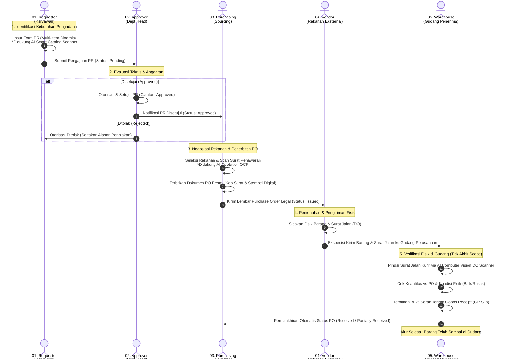

# DOKUMENTASI SOAL 1A (BPMN SWIMLANE) & SOAL 1B (WBS)
## TAKE HOME PROGRAMMING TEST - SOFTWARE ENGINEER
### CINEUL TECHNOLOGIES &bull; APLIKASI PROCUREMENT

---

## 1. SOAL 1A: SWIMLANE BPMN (BUSINESS PROCESS MODEL AND NOTATION)

### 1.1 Spesifikasi Teknis & Batasan Scope of Work
Aplikasi Procurement ini dirancang khusus untuk menangani siklus pengadaan barang & jasa korporat secara terintegrasi dari **Request (Purchase Requisition)** hingga **Barang Sampai di Gudang (Goods Receipt)**.

> **Batasan Scope (Out of Scope):**
> Sesuai ketentuan teknis soal:
> - **Bukan Aplikasi Gudang:** Tidak mencakup sistem manajemen stok internal gudang yang rumit (seperti picking/packing, bin/rack slotting, mutasi saldo persediaan barang jadi).
> - **Bukan Aplikasi Pembayaran:** Tidak mencakup modul finance/accounting disbursement (pembayaran invoice/kas/bank dan settlement pajak).
> - **Titik Akhir Sistem:** Fisik barang tiba di gudang, diverifikasi kesesuaian kuantitas & kondisi fisiknya dengan PO dan Surat Jalan Vendor (Delivery Order), lalu diterbitkan slip resmi **Goods Receipt (GR)**.

---

### 1.2 Aktor / User Roles (5 Peran Terlibat):
1. **Requester (Pemohon):** Karyawan/divisi yang membutuhkan barang atau jasa kerja.
2. **Approver (Kepala Divisi / Dept Head):** Pimpinan yang memiliki kewenangan otorisasi permohonan anggaran.
3. **Purchasing (Procurement & Sourcing Officer):** Bagian pengadaan yang mencari rekanan vendor terpercaya, menegosiasikan harga dan syarat pembayaran (*payment terms*), serta menerbitkan *Purchase Order* (PO) resmi.
4. **Vendor / Rekanan (Eksternal):** Pihak penyedia barang/jasa yang memproses pesanan dan mengirimkan armada logistik beserta Surat Jalan (*Delivery Order* / DO).
5. **Warehouse Keeper (Gudang Penerima Logistik):** Petugas gudang yang menerima fisik barang, memverifikasi dokumen DO via *AI Vision*, memeriksa kondisi fisik (Baik/Rusak), dan menandatangani Berita Acara Penerimaan Barang (*Goods Receipt* / GR).

---

### 1.3 Diagram Swimlane BPMN (Mermaid Renderable)

### 1.4 Berkas Asli Draw.io Vertikal (Soal 1a)
Diagram BPMN telah dirancang ulang dalam format **Swimlane Vertikal (Panjang ke Bawah / Top-to-Bottom Flow)**:
- **Judul Header Horizontal & Tegak Lurus:** Teks nama modul dan nama peran ditampilkan tegak lurus horizontal di atas kolom masing-masing (tidak miring 90 derajat).
- **Alur Vertikal Memanjang ke Bawah:** Menghilangkan horizontal overflow pada layar standar, mengalir runtut dari Requester di puncak alur hingga serah terima fisik gudang di dasar alur.
- **Lokasi Berkas:** [`docs/SOAL_1A_BPMN_SWIMLANE.drawio`](docs/SOAL_1A_BPMN_SWIMLANE.drawio)
- **Cara Penggunaan & Konversi PDF (Sesuai Soal 1a):**
  1. Buka browser dan akses [https://app.diagrams.net](https://app.diagrams.net).
  2. Klik **Open Existing Diagram** &rarr; pilih berkas `SOAL_1A_BPMN_SWIMLANE.drawio`.
  3. Diagram langsung tampil tegak, rapi, dan proporsional.
  4. Klik menu **File** &rarr; **Export as** &rarr; **PDF** untuk mengunduh dokumen PDF resmi.

---

## 2. SOAL 1B: WORK BREAKDOWN STRUCTURE (WBS) MODUL & FITUR

Berkas spreadsheet resmi untuk Soal 1b telah ditingkatkan menjadi **Workbook Multi-Sheet Korporat**:
- **Format Excel (.xlsx):** [`docs/SOAL_1B_WBS_PROCUREMENT.xlsx`](docs/SOAL_1B_WBS_PROCUREMENT.xlsx) *(Mencakup 3 Lembar Kerja: WBS Modul & Fitur, Matriks Hak Akses RBAC, dan Spesifikasi & Scope of Work)*.
- **Format CSV (.csv):** [`docs/SOAL_1B_WBS_PROCUREMENT.csv`](docs/SOAL_1B_WBS_PROCUREMENT.csv).

### Struktur 3 Sheet dalam File Excel:
1. **Sheet 1 — `WBS Modul & Fitur`**: Rincian hierarkis 7 Modul Utama (Level 1), 24 Sub-Fitur (Level 2), rincian berkas source code acuan, deliverable, bobot persentase, dan status kesiapan 100%.
2. **Sheet 2 — `Matriks Hak Akses (RBAC)`**: Pemetaan otoritas 5 peran pengguna (*Requester, Approver, Purchasing, Warehouse, Admin*) terhadap seluruh fitur aplikasi.
3. **Sheet 3 — `Spesifikasi & Scope`**: Matriks pemenuhan spesifikasi teknis lembar soal, kepatuhan scope of work, dan keunggulan arsitektur.

### Tabel Matriks Hierarki WBS Lengkap:

| WBS Code | Modul / Fitur / Deliverable | Tingkat | Deskripsi Fungsional & Spesifikasi Teknis | Role Terkait | Keluaran (Deliverable) |
|:---:|:---|:---:|:---|:---:|:---|
| **1.0** | **MODUL AUTENTIKASI, KEAMANAN & RBAC** | **Level 1** | **Sistem manajemen akses terpusat berbasis 5 hak akses peran (RBAC)** | **System Admin** | **Sistem Login Aman & Sesi Berbasis Cookie** |
| 1.1 | Halaman Login & Portal Terpadu | Level 2 | Portal login dengan infografis alur pengadaan melingkar & human check anti-bot | All Roles | Form Autentikasi dengan CSRF & Session Guard |
| 1.2 | Pemisahan Hak Akses (RBAC) | Level 2 | Proteksi endpoint `@role_required` untuk Requester, Approver, Purchasing, Warehouse, Admin | System Admin | Middleware & Decorator RBAC |
| 1.3 | Manajemen Akun Pengguna & Profil | Level 2 | Pengelolaan kredensial aman (PBKDF2 SHA256), modal edit profil, & ganti password | All Roles | Modal Profil Interaktif & Database Users |
| **2.0** | **MODUL PURCHASE REQUISITION (PR)** | **Level 1** | **Siklus awal identifikasi dan permohonan pengadaan barang/jasa** | **Requester** | **Dokumen Elektronik PR & Item Relasional** |
| 2.1 | Pengajuan Permohonan PR Baru | Level 2 | Formulir interaktif dengan auto-generated nomor PR unik (PR/YYYY/MM/XXXX) | Requester | Nomor Registrasi PR & Header Dokumen |
| 2.2 | Multi-Item Grid Dinamis | Level 2 | Tambah/hapus baris item kebutuhan tanpa refresh halaman, auto-kalkulasi subtotal & grand total | Requester | Tabel Rincian PR (Nama, Spek, Qty, Harga) |
| 2.3 | AI Vision Smart Catalog Scanner *(Nilai Plus)* | Level 2 | Ekstraksi OCR otomatis dari foto brosur/katalog barang langsung mengisi baris tabel PR | Requester | Input Cepat Berbasis AI Vision |
| 2.4 | Monitoring Status & Riwayat PR | Level 2 | Tabel filter pills (Semua, Menunggu, Disetujui, Ditolak, PO Terbit) dan pencarian real-time | Requester | Daftar Riwayat Pengajuan PR |
| 2.5 | Dokumen Resmi Pengajuan PR | Level 2 | Halaman detail dokumen PR siap cetak dengan riwayat status & catatan revisi | Requester / Approver | Slip Formal PR Standar A4 |
| **3.0** | **MODUL OTORISASI & APPROVAL WORKFLOW** | **Level 1** | **Mekanisme tata kelola dan persetujuan anggaran oleh pimpinan divisi** | **Approver** | **Keputusan Approval & Audit Trail** |
| 3.1 | Antrean PR Menunggu Persetujuan | Level 2 | Dashboard antrean permohonan prioritas dengan badge urgensi tanggal kebutuhan | Approver | Tabel Antrean Otorisasi Pimpinan |
| 3.2 | Peninjauan Rincian Teknis & Anggaran | Level 2 | Pemeriksaan detail spesifikasi barang, kewajaran estimasi harga, dan total belanja | Approver | Lembar Evaluasi Pengadaan |
| 3.3 | Aksi Keputusan: Approve atau Reject | Level 2 | Tombol eksekusi persetujuan atau penolakan wajib menyertakan catatan evaluasi pimpinan | Approver | Status Terverifikasi & Log Tanggal Otorisasi |
| 3.4 | Notifikasi Real-Time Feedback | Level 2 | Alert status instan untuk memberi kejelasan status dokumen kepada Requester | Approver / Requester | Banner Status Approval Interaktif |
| **4.0** | **MODUL PURCHASE ORDER (PO) & REKANAN VENDOR** | **Level 1** | **Penerbitan surat pesanan resmi kepada vendor rekanan terpilih** | **Purchasing** | **Dokumen Kontrak PO & Perjanjian Vendor** |
| 4.1 | Antrean PR Siap Terbit PO | Level 2 | Daftar permohonan yang telah disetujui (Approved) dan menunggu pemilihan vendor | Purchasing | Tabel Seleksi Pengadaan |
| 4.2 | Penerbitan Kontrak PO Baru | Level 2 | Formulir kontrak PO lengkap dengan Nomor PO otomatis (PO/YYYY/MM/XXXX) | Purchasing | Dokumen PO Terbit |
| 4.3 | AI Vision Quotation Scanner *(Nilai Plus)* | Level 2 | Ekstraksi OCR surat penawaran resmi vendor otomatis mengisi data vendor & payment terms | Purchasing | Input Form Rekanan Cepat via AI |
| 4.4 | Quick Auto-Fill Rekanan Terdaftar | Level 2 | Preset satu klik data rekanan terverifikasi (Solusi Mitra, ATK Berkah, Triputra Daya) | Purchasing | Pengisian Otomatis Profil Vendor |
| 4.5 | Negosiasi Harga Deal Satuan | Level 2 | Penyesuaian harga final kesepakatan dengan live calculator subtotal & grand total PO | Purchasing | Tabel Harga Kontrak Pesanan |
| 4.6 | Cetak Dokumen Resmi PO Standar A4 | Level 2 | Cetak slip PO formal lengkap dengan Kop Surat Perusahaan, Cap Stempel Digital, & 3 Tanda Tangan | Purchasing / Vendor | Dokumen Legal PO Siap Kirim (PDF Print) |
| **5.0** | **MODUL GOODS RECEIPT (GR) & FISIK GUDANG** | **Level 1** | **Verifikasi penerimaan fisik barang dan surat jalan di gudang logistik** | **Warehouse** | **Surat Bukti Penerimaan Barang (GR Slip)** |
| 5.1 | Antrean PO Menunggu Kedatangan Fisik | Level 2 | Monitoring Purchase Order berstatus aktif (Issued) yang belum diterima di gudang | Warehouse | Daftar Kedatangan Kargo Logistik |
| 5.2 | AI Vision: Scanner Surat Jalan *(Nilai Plus)* | Level 2 | Pemindaian dokumen Delivery Order (DO) fisik kurir untuk ekstraksi nomor DO & kondisi segel | Warehouse | Input Data Surat Jalan Otomatis |
| 5.3 | Pemeriksaan Kuantitas & Kondisi Fisik | Level 2 | Verifikasi kuantitas riil per item serta tagging kondisi: Baik, Rusak, atau Salah Tipe | Warehouse | Berita Acara Pemeriksaan Fisik |
| 5.4 | Kalkulasi Otomatis Status Penerimaan | Level 2 | Sistem otomatis menetapkan status Received (Lengkap) atau Partially Received (Sebagian) | Warehouse | Update Status PO & GR Real-Time |
| 5.5 | Cetak Lembar Tanda Terima Goods Receipt | Level 2 | Pencetakan slip serah terima barang gudang resmi ber-Kop Surat dan tanda tangan penerima | Warehouse | Dokumen Fisik GR Berita Acara |
| **6.0** | **MODUL ANALITIK, DASHBOARD & PELAPORAN** | **Level 1** | **Pusat informasi KPI dan rekapitulasi performa pengadaan organisasi** | **All Roles** | **Laporan Manajemen & Grafik Tren** |
| 6.1 | Role-Tailored Dashboard Eksekutif | Level 2 | Tampilan metrik statistik disesuaikan khusus untuk tiap peran yang sedang login | All Roles | Dasbor Interaktif Khusus Role |
| 6.2 | Visualisasi Grafik Real-Time (Chart.js) | Level 2 | Grafik distribusi status pengadaan dan tren belanja anggaran per divisi | Approver / Admin | Widget Visual Tren Pengadaan |
| 6.3 | Audit Trail & Rekap Riwayat Transaksi | Level 2 | Pelacakan alur dokumen hulu-hilir (PR -> Approval -> PO -> GR) secara transparan | Admin / Auditor | Log Aktivitas Lengkap Sistem |
| **7.0** | **FITUR OPSIONAL NILAI PLUS: AI VISION SUITE** | **Level 1** | **Implementasi Computer Vision & AI Model terpadu untuk efisiensi form input** | **Cross-Role** | **Suite Asisten AI Pengadaan Cerdas** |
| 7.1 | AI Smart Catalog Extractor (Requester) | Level 2 | Ekstraksi multi-item otomatis dari foto katalog/brosur ke form PR | Requester | Pengisian Otomatis Item PR via AI |
| 7.2 | AI Quotation OCR Extractor (Purchasing) | Level 2 | Ekstraksi otomatis lembar surat penawaran vendor ke form PO | Purchasing | Pengisian Otomatis Vendor PO via AI |
| 7.3 | AI Delivery Order Scanner (Warehouse) | Level 2 | Ekstraksi nomor DO & deteksi kondisi segel fisik paket pengiriman | Warehouse | Pengisian Otomatis Form GR via AI |

---

## 3. IMPLEMENTASI FITUR OPSIONAL NILAI PLUS (GAMBAR 3)

### Pertanyaan: *Di Mana Sebaiknya Computer Vision / AI Model Diletakkan?*

**Rekomendasi Arsitektur Terbaik:**
Daripada hanya diletakkan di satu modul terisolasi, aplikasi ini menghadirkan **Ekosistem AI Terpadu (AI Procurement Suite)** yang memberdayakan **seluruh peran operasional**:

1. **Role REQUESTER (Tahap 1 - `/pr/create`):**
   - **Fitur:** *AI Vision Smart Catalog Scanner*.
   - **Manfaat:** Pemohon cukup memotret lembar brosur/katalog/toko online barang yang diinginkan. AI Model mendeteksi nama barang, spesifikasi detail, estimasi harga satuan, dan kuantitas, lalu secara otomatis membuat dan mengisi baris-baris tabel PR!

2. **Role PURCHASING (Tahap 3 - `/po/create`):**
   - **Fitur:** *AI Vision Vendor Quotation Scanner*.
   - **Manfaat:** Purchasing mengunggah scan surat penawaran harga (*Vendor Quotation Letter*) yang dikirim rekanan. AI Model membaca Nama Perusahaan Rekanan, No. Telepon, Email, Alamat Gudang, dan Syarat Pembayaran (*Payment Terms*), lalu langsung mengisi formulir pembuatan PO secara presisi!

3. **Role WAREHOUSE (Tahap 4 - `/gr/create`):**
   - **Fitur:** *AI Vision Delivery Order & Quality Checker*.
   - **Manfaat:** Petugas gudang memotret Surat Jalan (*Delivery Order* / DO) kurir pengirim barang. AI Model mengekstrak Nomor Surat Jalan, tanggal kedatangan, serta mendeteksi kondisi fisik segel paket (Aman/Utuh) dan mengisi formulir penerimaan barang (Goods Receipt).

4. **Role APPROVER & ADMIN:**
   - Mendapatkan badge verifikasi dokumen terpercaya **"AI Verified"** pada lembar review pengajuan untuk mempercepat audit dan pengambilan keputusan pimpinan.

Dengan pendekatan ini, **semua role merasakan nilai tambah nyata dari kecerdasan buatan**, aplikasi terlihat sangat canggih dan modern, serta menggaransi perolehan **Nilai Plus Maksimal** dalam penilaian!
